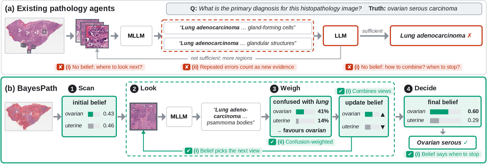

<h1 align="center">BayesPath: Reliability-Aware Bayesian Reasoning for Whole-Slide Pathology Agents</h1>

<p align="center">
  <a href="https://github.com/bryanwong17/BayesPath">
    
  </a>
  <a href="https://arxiv.org/abs/2611.33935">
    
  </a>
  <a href="https://arxiv.org/pdf/2611.33935">
    
  </a>
</p>

## 📣 Updates

* **2026.11.25** — Released the paper on [arXiv](https://arxiv.org/abs/2611.33935). The code will be released soon.

## 🚀 Overview

We propose **BayesPath**, a **training-free** whole-slide image (WSI) agent that casts the pathologist's **Scan–Look–Weigh–Decide** process as **reliability-aware Bayesian reasoning**. An explicit belief over the candidate answers is updated with each observation through a reliability-aware likelihood, and this belief decides both where to look next and when the evidence is sufficient to stop.

<p align="center">
  
</p>

## Citation

If you find our work useful in your research, please consider starring 🌟 this repo and citing our [paper](https://arxiv.org/abs/2611.33935) at:

```
@article{wong2026bayespath,
  title={BayesPath: Reliability-Aware Bayesian Reasoning for Whole-Slide Pathology Agents},
  author={Wong, Bryan and Xu, Xun and Kim, Jongwoo and Fu, Huazhu and Chen, Nancy F. and Yi, Mun Yong},
  journal={arXiv preprint arXiv:2611.33935},
  year={2026}
}
```
